<p align="center">
  
</p>

<p align="center">
  
  
  
  
</p>

<p align="center"></p>

<table>
<tr>
<td width="55%" valign="top">

### `$ whoami`

```text
fabio@kernelphantom:~$ cat about.txt

[>] Building        NexusDefend
[>] Learning        Windows Internals
[>] Interested in   Reverse Engineering
[>] Focus           Low-Level Development
[>] Field           Cybersecurity
```

### `$ contact`

[](mailto:boyeinschaf@gmail.com)
[](https://github.com/KernelPhantom-010)

</td>
<td width="45%" align="center" valign="middle">

```text
.
           .
                      *
                    +***+++=-:
                 #%@%%%###**+=-:.
                @@@%%###***++==;:.  *
             -#%%##****++++==-;;:.  -      .
  *    -= ==: ++++++++++++==-;;:,.   :==.=-
    -= =:    -==+++******++=-;:,,.       := =-
    = =:     -=+**######**+=-;:,.         := =
    -= =:    -+*##%%##**+==-;:,.         := =-
       -= ==: =+****++==-;;:,,.      :== =-
             -====-====::::====  ===-            .
                :::::,,,...
     .            ......                    *
```

</td>
</tr>
</table>

<p align="center"></p>

## `[ Tech Stack ]`

<p align="center">
  
</p>

<p align="center"></p>

## `[ GitHub Stats ]`

<p align="center">
  
</p>

<p align="center">
  
  
</p>

<p align="center"></p>

<p align="center"><sub><code>Break. Reverse. Understand. Repeat.</code></sub></p>
